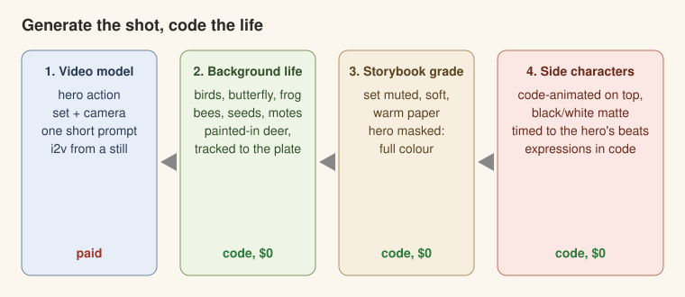

# Living scenes: generate the shot, code the life

*A hybrid method found on a 10-second, three-shot sequence (2026-11): a strong cartoon character rips a dead tree out
of a hill, carries it and lays it across a river as a bridge, while small ball characters bounce along and the
landscape is full of birds, a butterfly, a frog, deer, bees and dandelion seeds.*

**The idea.** A video model is great at one big, physical, camera-aware action in a painted set, and bad at
everything small: insects, distant animals, seeds in the light, a bird landing in the right place at the right
moment, side characters who must stay on-model and do exactly what you say. So split the work:

| Layer | Made by | Why |
|---|---|---|
| The hero action, the set, the camera | **a video model** (one short prompt per shot, image-to-video from a still) | real weight, real camera, real light |
| Side characters (ball characters, sidekicks) | **code animation** (`tools/edit/bounce.py`), composited by black/white difference matting | always on-model, exact timing, free re-takes |
| Background life (birds, butterflies, frogs, bees, seeds, motes) | **code** (`tools/living/life.py`) with drawings from a painted sheet | placed and timed to the action, $0 per change |
| Realistic far animals (deer on a bank) | **an image edit paints them into one frame**, cut out, **tracked to the plate** | they look like part of the painting, not stickers |
| The grade | **code**: mute the set like a storybook, keep the characters bright | characters pop; set stays alive |

Every note after the hero shots ("move the butterfly to the left side of the trunk", "the frog jump sucks", "no
duck", "the berries should chase the bird off") was a code change: seconds to re-render, no generation spend. On the
example sequence the three video takes that shipped cost about $3, plus ~$0.70 of stills and sheets. Everything after that was free.

## The pipeline (order matters)

1. **Stills first.** One plate per location; a start still for any shot that must *start in a state* (tree on the
   shoulder, standing at the bank). Get them approved.
2. **The hero shots** (video model, 480p while exploring). See [Prompting the hero shot](#prompting-the-hero-shot).
3. **Clean cut.** Trim and re-time in the edit (2x on the wind-ups, 1x on the payoff). Nothing drawn yet.
4. **Background life on the clean cut** (`life.py`): critters, tracked patches, seeds, insects.
5. **Grade** the result: storybook grade on everything except the hero's mask (SAM 2 video masks where it can find
   him; a colour key where he is small in frame).
6. **Side characters on top, after the grade**, so they keep full colour.
7. **Sound** on the real events (see [SOUND.md](SOUND.md)), then the QA gates ([QA.md](QA.md)).

Keep each stage a separate file in and file out (`cut_clean.mp4 -> animals_bg.mp4 -> graded_bg.mp4 -> final.mp4`),
so a note on one layer re-runs only that layer and the ones after it.

## Prompting the hero shot

- **Short beats long.** One sentence chain of the action and its END state, ~40-60 words, refs carrying the look:
  "X gives the tall dead pine a light push and lets it topple to the right. It falls across the wide river and lands
  with a thud and a splash, lying from the left bank to the right bank. It stays there. He dusts his hands and pats it."
  This beat 200-word spec-sheet prompts for naturalness. **Intent-only** prompts ("bridges the creek, proud") gave
  the model too much room: it rewrote the task and invented business (a bodybuilder flex).
- **No holds in the prompt.** Add holds, speed ramps and pauses in the edit.
- **Name the count.** "One X, one tree." Stops duplicates.
- **Say what must NOT change** when the model likes to improve things: "dead the whole time, no leaves, no green".
- **Stage for the camera.** In a side view, "across the river" means *into depth* and never reads. Put the camera
  looking DOWN the river so the bridge lies left-to-right across the frame.
- **A shot that starts in a state needs an image-to-video start still.** Refs-only generation is fine for a shot that
  starts from nothing (a pull out of the ground); a carry must start with the tree already on the shoulder.
- **First and last frame together need the same camera AND the character where he naturally ends up.** An end still
  framed ~6% wider made the model hard-cut to it mid-take; an aligned end still with the character moved made it
  cross-dissolve to a ghost. What worked: take a frame from a good take *at the moment the action is nearly done*,
  edit only what is wrong in it (the tree lying across, no leaves), and use that as the end frame. One continuous take.
- **Watch the model's favourite off-model details** (abs on a round character, leaves sprouting on a dead tree) in
  every frame, not one: say "fixed" only after checking all of them.

## Background life: rules

- **Background animals take the PLATE's style, not the character style.** Cel-outlined cartoon animals on a
  gouache set read as stickers. Paint the sheet with the plates as references: same brushwork, no outlines, same light.
- **An animal that moves needs pose drawings** (crouch, stretched leap, landing), never one sprite slid along an arc.
  Startle on the impact frame, anticipate, then ONE big stretched leap out of frame.
- **For realistic far animals, paint them INTO a frame of the shot** with an image edit, cut them out by difference
  (blurred difference > 0.07, colour-filtered, biggest blobs), and track that patch to every frame
  (`track_plate`: ORB features on static scenery + RANSAC similarity + 7-frame median). ECC drifted and skewed them.
  A second edit of the same frame gives a second state (head down -> head up), swapped at the event.
- **Things in front stay in front.** Where the frame differs a lot from the tracked plate (a splash), hide the patch.
  Draw the plate's own grass back over hooves and feet.
- **Place against the real geometry.** Measure it from the frame (where exactly is the bark at that height, where
  is the log's top edge) instead of guessing; a butterfly "on the tree" that floats 10 px off the bark reads as wrong.
  Anything that should sit on water, in a tree or on a bank must have a visible surface under it, or it reads as
  floating in the air (a bobbing duck with no visible water line was cut).
- **Every critter reacts to the story.** The butterfly takes off as the roots tear; the frog leaps at the splash;
  the deer look up at the splash (both of them); a bird lands on the new bridge and the side characters chase it
  off. Life that ignores the action is wallpaper.
- **Screen direction for exits.** Things leave the side the viewer expects (away from the action, or the side the
  director names), and fully leave the frame.
- **Small is the point.** Bees ~4 px with a faint thin trail, "almost not seeable". Seeds and motes drift with
  depth (near = bigger, faster, softer) and parallax against camera moves.
- **Background critters on twos** (`on_twos`) read hand-made; flappers are sized by WIDTH because wing-up and
  wing-down drawings differ in height.
- **Remove before you add.** If something reads wrong (a bunny that looks like it sits in a tree), cut it.

## Side characters over a generated shot

- Animate them in code (`tools/edit/bounce.py` for limbless ball characters), render each shot twice, over black and
  over white, and get exact alpha with `bw_matte` (soft edges, shadows and dust included).
- **Set the engine's frame size** to the plate's (it may default to 9:16).
- **Their path follows the hero's beats:** a hop as he pushes, a celebration on the splash, then off along the new
  bridge. Never cross the hero's face; go in front of his feet or straight up onto the prop.
- **Expressions drawn in code** on the approved sprites (squeezed `> <` eyes, `^ ^` joy, a wide-eyed wow), timed to the
  beats: wow on the reveal, squeeze while bouncing, joy on the settle.

## The storybook grade

`storybook_grade(frame, mask)`: the set keeps 60% of its colour, contrast x0.86 with lifted shadows, a warm paper tint
and 5% cream; the character under the mask keeps full colour (saturation x1.06). The landscape stays *alive* (its
motion is untouched); only its colour steps back. Get the mask from SAM 2 video (hosted on fal, a point prompt on the
character, a few cents per shot); when SAM loses a small character, key his own colours (body, trousers, boots) inside a zone around him.
Check that no ungraded box or wrong patch (a belt colour matching the dirt) shows.

## Cost and speed (the example sequence)

| Item | Cost |
|---|---|
| 3 shipped hero takes (Seedance 2.5 i2v, 480p, 5 s) | ~$3.10 |
| Plates, start/end stills, animal sheets, deer edits (GPT Image 2 medium) | ~$1.10 |
| Takes and stills thrown away while learning the rules above | ~$15 |
| All background life, side characters, grade, re-timing, 10 rounds of notes | **$0** |
| One full re-render of all layers (854x480, 9.7 s) on a laptop CPU | ~1-2 min |

## Tools

`tools/living/life.py` (numpy + OpenCV only): `cut_sheet`, `place`, `shadow`, `bee` + `loop_path`, `Drift`,
`bird_sprite`, `on_twos`, `track_plate`, `diff_matte`, `TrackedPatch`, `storybook_grade`, `mask_from_video`,
`bw_matte` / `over`, `read_frames` / `Writer`. `tools/living/demo.py` runs on any clip with no assets:
`python tools/living/demo.py in.mp4 out.mp4 [--mask mask.mp4]` adds bees, seeds, motes and a small flock, then the
storybook grade. See [tools/living/README.md](tools/living/README.md).

## Checklist per shot

- [ ] Hero take: one continuous take, on-model in EVERY frame, the end state reached.
- [ ] Each critter has a surface under it, a reason to move (tied to a beat) and an exit that fully leaves frame.
- [ ] Critters in the plate's painted style; moving ones have pose drawings.
- [ ] Tracked patches don't jitter or skew; hidden behind anything nearer; feet in the grass.
- [ ] Side characters on top, after the grade; never across the hero's face.
- [ ] Grade: no ungraded box around the hero, no stray patches.
- [ ] Sound on every contact and exit; then the QA gates.
